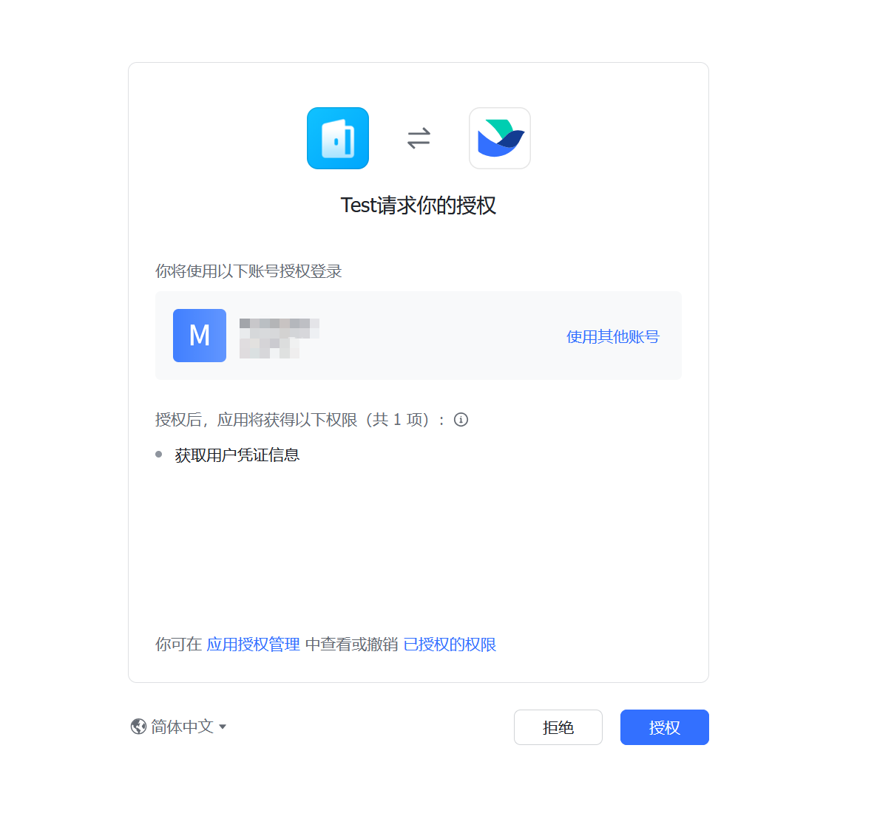
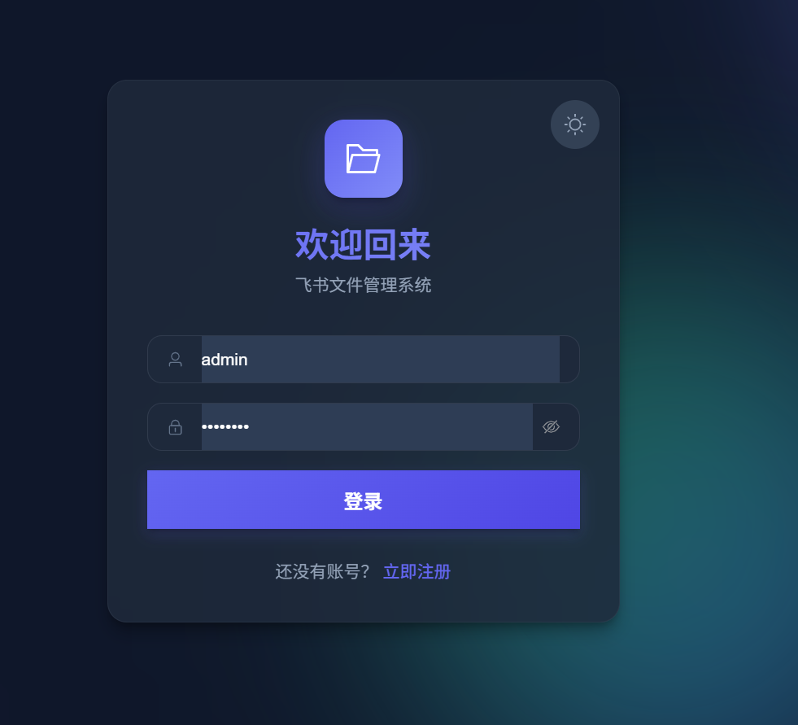
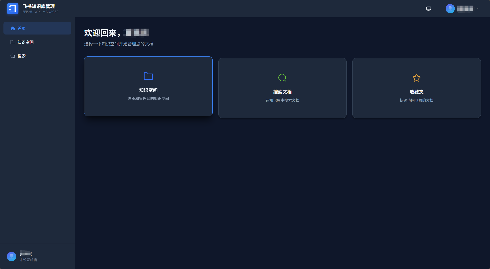
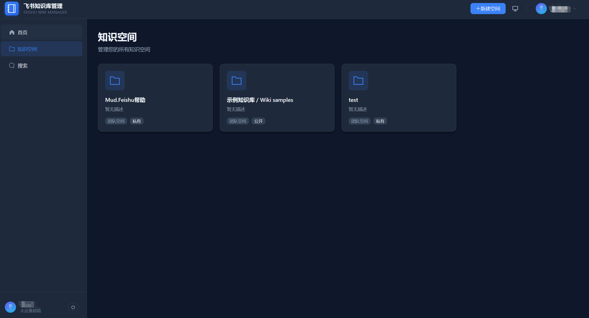
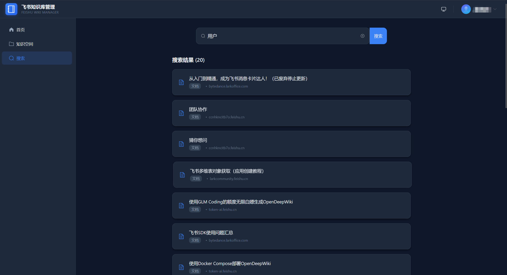
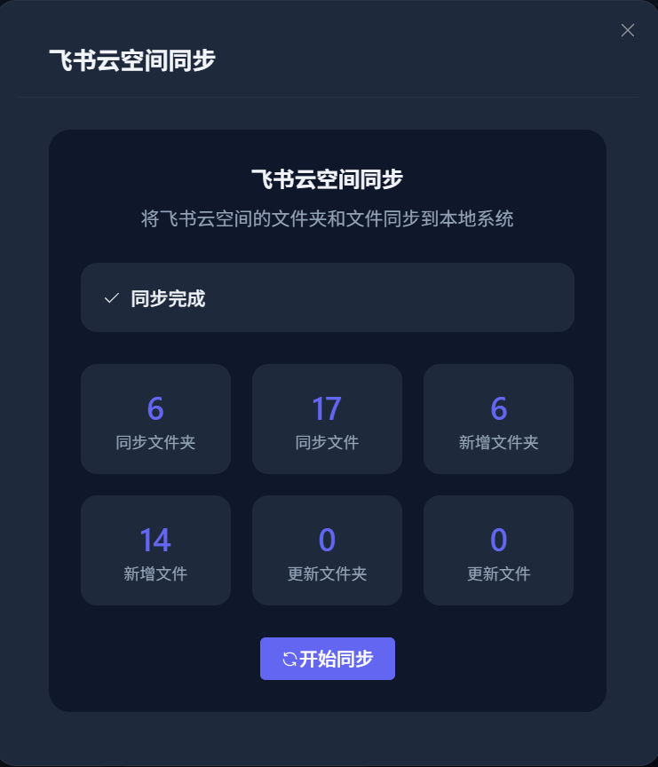
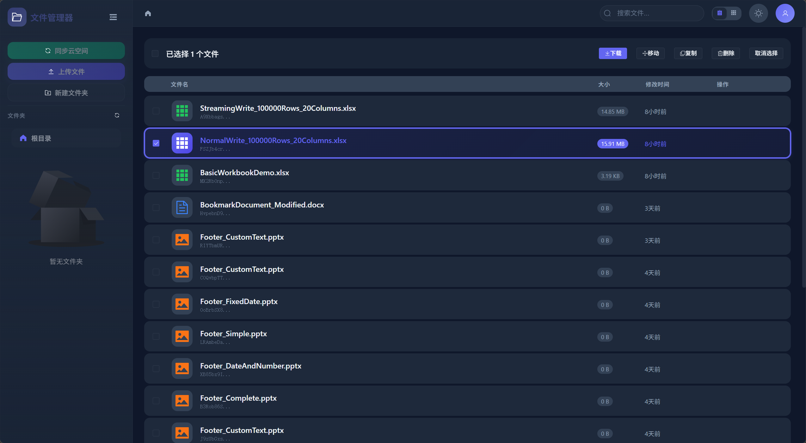
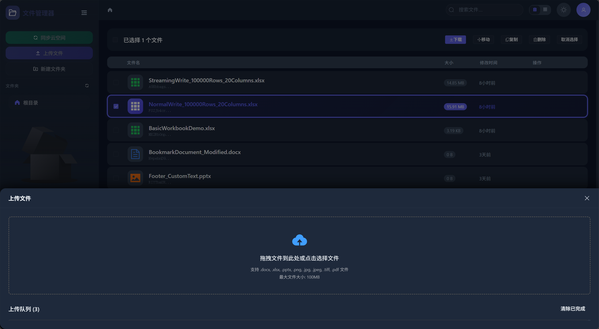

# MudFeishu

<div align="center">


The **AI-native** .NET SDK for the Feishu ecosystem — 182 curated tools + an Agent runtime + an MCP server + a human-approval pipeline,
letting AI agents drive Feishu org, docs, approvals, calendar, tasks, Bitable and 25 business domains in total through natural language.

[](LICENSE)
[](https://www.nuget.org/packages/Mud.Feishu/)
[](https://www.nuget.org/packages/Mud.Feishu.AI/)
[](https://www.nuget.org/packages/Mud.Feishu.AI.Tools/)
[](https://www.nuget.org/packages/Mud.Feishu.WebSocket/)
[](https://www.nuget.org/packages/Mud.Feishu.Webhook/)

[Why](#why-we-built-this) • [Architecture](#the-ai-foundation-five-layer-architecture) • [Install](#installation) • [Quick Start](#quick-start) • [Packages](#package-family) • [Quality Gate](#quality-gate)

</div>

---

## Why We Built This

Feishu SDKs have long been a blank spot in the .NET ecosystem. The one community project that exists stopped at "I can call a few
endpoints" — narrow coverage, no multi-app support, no real-time events, no AOT, and certainly no AI capability. When an AI agent has to
**operate Feishu autonomously** (create an approval, update a Bitable table, send an email, manage a calendar), that foundation simply
does not connect:

- An agent needs strongly-typed parameter schemas, not `Dictionary<string, object>` + reflection.
- Write operations need permission tiers, idempotency guarantees and human confirmation, not blanket pass-through.
- Multi-tenant scenarios need scope isolation, not a process-wide global singleton.
- An MCP tool server needs Native AOT single-file cold start, not `Newtonsoft.Json` reflection serialization.

MudFeishu fills exactly that blank — not "yet another SDK that can call endpoints", but **the first Feishu foundation designed for the
AI agent era on .NET**:

- **182 curated tools** expose the Feishu API to models as Function Calls at compile time. Every tool carries a strongly-typed schema,
  a risk level, a permission scope and idempotency semantics — this is not dumping 1268 SDK methods onto the model indiscriminately.
- A **seven-step execution chain** runs on every tool call: context validation → inbound sanitization → policy axis → authorization gate →
  tenant switch → content safety → outbound sanitization, **fail-closed by default**: an unauthorized write tool is always rejected.
- A **human-confirmation pipeline** makes high-risk operations (send message, create approval, delete record) wait for host approval
  before executing. Approval state has a single owner, so the model can never self-approve.
- An **MCP server** exposes the very same tool surface to out-of-process agents (Claude Code / Cursor / your own harness) over
  stdio JSON-RPC, with zero bypass of the execution chain.
- **Skills artifacts** ship inside the NuGet packages, so out-of-repo agents can run `npx skills add` and instantly obtain Feishu domain knowledge.

AI capability is not a patch on the sample layer — it is a **first-class citizen** of the SDK.

---

## The AI Foundation: Five-Layer Architecture

```
┌─────────────────────────────────────────────────────────────┐
│  ⑤ Ecosystem  MCP Server (stdio)  ·  Skills export          │
├─────────────────────────────────────────────────────────────┤
│  ④ Agent     Session management  ·  Streaming channel       │
│              Event-driven conversation                      │
│              Knowledge retrieval (Aily + RAG)  ·  HITL      │
├─────────────────────────────────────────────────────────────┤
│  ③ Tooling   182 curated tools (25 domains)                 │
│              Compile-time schema  ·  Risk tiers             │
│              Idempotency keys  ·  affordance assets         │
├─────────────────────────────────────────────────────────────┤
│  ② Chain     Inbound sanitization → policy axis             │
│              → authorization → tenant switch                │
│              → content safety → outbound sanitization → audit│
├─────────────────────────────────────────────────────────────┤
│  ① SDK Base  1268 strongly-typed interfaces                 │
│              Source-generated JSON  ·  AOT net-zero         │
│              Multi-app scopes  ·  Full token lifecycle      │
└─────────────────────────────────────────────────────────────┘
```

### ① SDK base: 1268 strongly-typed interfaces, invisible to agents, visible to the tool surface

All 20+ Feishu API modules (org structure, messaging, group chat, approvals, tasks, calendar, video conferencing, docs, wiki, drive,
whiteboard, spreadsheets, Bitable, attendance, cards, AI capabilities, mail, search, help desk, OKR, Minutes, Miaoda, …) are
declarative interfaces plus source-generated implementations. Agents never call these interfaces directly — **the tool surface curates
182 high-frequency operations out of them** and exposes those to the model.

### ② Execution chain: seven immutable steps, fail-closed by default

```
① appKey context validation
①' Inbound sanitization    — control chars / dangerous Unicode / lone CR → reject (invalid_args), zero downstream calls
② Policy axis              — MaxToolRisk / AllowedIdentities → reject (policy_denied: reason_code)
③ Authorization gate       — IToolExecutionAuthorizer → reject (authorization_denied)
                            NeedsUserConfirmation → notify host approval channel, neutral rejection (no credentials at all)
④ Tenant context switch    — BeginScope(appKey)
④' User context            — identity=user tools only: write into AsyncLocal, cleared in finally
⑤ Content safety           — 4 injection rules scan the raw result (off | warn | block)
⑥ Outbound sanitization (mandatory)
                            — strip ANSI/control chars + redact credentials and phone numbers; no switch, not bypassable
⑦ Shaping hook + audit     — IToolResultShaper (nullable) + IToolExecutionAuditSink (allow / deny / error delivery)
```

**Key security properties**: inbound is a *rejection*, not a *strip* (stripping would silently rewrite user content); outbound
sanitization has no switch and cannot be bypassed; a pending-confirmation call whose authorizer did not return `Allowed` is
suspended and resolved through **the same path for read and write tools**; `dry_run=true` on a write tool does not consume an idempotency key.

### ③ Tool surface: 182 curated tools, not 1268 bare methods

| Domain | Read | Write | Total | | Domain | Read | Write | Total |
| --- | ---: | ---: | ---: | --- | --- | ---: | ---: | ---: |
| Bitable | 6 | 3 | 9 | | OKR | 9 | 6 | 15 |
| Docs | 8 | 9 | 17 | | Video conferencing | 6 | 4 | 10 |
| Wiki | 2 | 3 | 5 | | Knowledge base | 1 | — | 1 |
| Search | 1 | — | 1 | | Whiteboard | 2 | 4 | 6 |
| IM | 8 | 8 | 16 | | Attendance | 7 | 1 | 8 |
| Drive | 3 | 12 | 15 | | Miaoda | 5 | 5 | 10 |
| Spreadsheets | 2 | 2 | 4 | | AI text | 2 | — | 2 |
| Contact | 8 | — | 8 | | Mail | 5 | 2 | 7 |
| Approval | 2 | 4 | 6 | | Minutes | 5 | — | 5 |
| Calendar | 3 | 4 | 7 | | Tasks | 1 | 7 | 8 |
| Org | 8 | — | 8 | | Hiring | 7 | — | 7 |
| Security | 2 | — | 2 | | MDM | 1 | — | 1 |
| Meta tools | 4 | — | 4 | | **Total** | **108** | **74** | **182** |

**Curated, not fully exposed**: dumping 1268 SDK methods onto the model indiscriminately means context explosion plus impossible
permission tiering. MudFeishu curates 182 tools around high-frequency workflows, and every tool has:

- **Compile-time schema** (`FeishuToolSchemas`): parameters, risk level, permission scope, whether it writes, SDK source anchor
- **Typed contracts** (`FeishuToolContracts`): zero runtime parsing, the registry constructs the definitions directly
- **Per-tool affordance** (`x-feishu.affordance`): when to use it / when not to, preconditions, pitfall notes
- **Domain guidance** (25 domains plus sub-topic references): appended after host instructions, truncated at a 2 KB budget

When the model meets a capability that is not curated, the correct action is to ask `feishu.capability_lookup` (to tell "does not
exist" apart from "not curated") and then **report honestly to the user** — instead of inventing a call. **There is no universal
fallback channel** (it was deleted as a whole; a dual call path is the highest-risk design).

### ④ Agent runtime: sessions, streaming, knowledge, event-driven

```csharp
builder.Services.AddFeishuApp(builder.Configuration);
builder.Services.AddFeishuTools();                    // tool surface
builder.Services.AddFeishuAgent(builder.Configuration) // Agent runtime
    .AddFeishuEditMessageChannel()                    // streaming message channel (edits an already-sent message)
    .AddFeishuImConversationHandler();                // IM events → conversation
```

- **Streaming message channels**: `EditMessageChannel` (streams by editing an already-sent message), `CardStreamMessageChannel`
  (card stream), `StreamingChannelChain` (chain them together) — an agent's streamed reply becomes a live-updating Feishu message.
- **Event-driven conversation**: `ConversationalFeishuEventHandler` turns Feishu events (IM message received / approval task /
  task change / Bitable record change) into model-processable context plus a reply. Event payloads are assembled by
  `IContextAssembler` into structured fragments (with untrusted markers, over-budget truncation, missing-field degradation).
- **Knowledge retrieval**:
  - **RAG-A (Aily hosted)**: `AilyKnowledgeProvider` plugs into Feishu Aily knowledge Q&A — zero infrastructure.
  - **RAG-B (self-hosted retrieval)**: `DocumentChunker` (structure-first chunking) → `VectorRetriever` → `CorpusIndexer`, where the
    vector store and embeddings are supplied by the host (the SDK takes no dependency). `CorpusChunk.ScopeKey` must be isolated per tenant.
  - The two retrieval surfaces use `TryAddSingleton`: whichever registers first wins, and **coexisting never conflicts**.
- **HITL approval continuation**: one `FeishuAgent.RunApprovalContinuationAsync` call performs load session → fetch the original
  approval request → rebuild tenant context → continue the run → persist. The sole owner of approval state is the host authorizer;
  the SDK issues no credentials whatsoever, so the model cannot self-approve.

### ⑤ Ecosystem: MCP server + Skills export

**MCP server** (`Mud.Feishu.AI.Mcp`, an independent optional package):

```csharp
builder.Services.AddFeishuTools();
builder.Services.AddFeishuMcpServer(o => o.AppKey = "cli_xxx");
await app.Services.RunFeishuMcpStdioAsync();   // blocks until the client closes stdin
```

- The allow-list has a single source of truth (tools exposed over MCP == `FeishuAgent:Tools` + `WriteAllowList`, no new switches)
- Zero bypass of the execution chain (every tool call goes through the same `FeishuToolBinding`)
- Tenant boundary = process (appKey comes only from configuration; accepting appKey over the protocol would hand tenant switching to the client)
- The protocol layer is self-implemented (no dependency on the official `ModelContextProtocol` SDK, covering only the `tools` capability + stdio)

**Skills artifacts** (shipped inside the NuGet packages):

```csharp
IToolSchemaExporter.Export(ToolSchemaDialect.Skills);
// => {"dialect":"skills","files":[{"path":"skills/feishu-im/SKILL.md","content":"…"}, …]}
```

`skills/feishu-{domain}/SKILL.md` plus `references/{topic}.md` for all 25 domains, loadable directly by out-of-repo agents
(Claude Code / Cursor) to obtain Feishu domain knowledge. Every data source is a compile-time constant ⇒ zero reflection, zero IO, deterministic.

**NDJSON event bridge** (a Demo reference implementation; not part of the shipped API since R-10): `FeishuEventNdjsonBridge`
hands Feishu events to any out-of-repo process as one-event-per-line NDJSON, with `payload` embedded verbatim
(no longer re-serialized), which avoids field loss and AOT reflection back doors. The implementation lives in
`Demos/Mud.Feishu.Agent.Demo/Events/FeishuEventNdjsonBridge.cs` (~370 lines, zero SDK dependency) and has a real call
site in `Modes/DomainEventsDemo.cs`.

---

## Full Feishu API Coverage

| Module | API version | Main features |
| --- | --- | --- |
| Authentication | V3 | App/tenant/user tokens, OAuth 2.0, multi-app management |
| Organization | V1/V3 | Users, departments, employees, user groups, job levels, positions, roles |
| Messaging | V1 | Text/image/card messages, batch sending, group chat management |
| Approval | V4 | Approval definitions, instances, tasks, messages, subscriptions |
| Tasks | V2 | Task creation, updates, groups, attachments, comments, custom fields |
| Calendar & meetings | V4 | Calendar management, calendar events, ACL access control |
| Video conferencing | V1 | Meetings, meeting rooms, configuration, export, recordings, minutes, reports |
| Docs | V1 | Feishu docs, document blocks, content conversion |
| Wiki | V2 | Knowledge spaces, node management, copy and move |
| Drive | V1 | Cloud space, folders, upload, versions, permissions, comments, subscriptions |
| Whiteboard | V1 | Board themes, thumbnails, nodes, DSL parsing |
| Spreadsheets | V2/V3 | Spreadsheets, ranges, filters, data validation, conditional formatting |
| Bitable | V1/V2 | Tables, records, fields, views, forms, dashboards, roles, automation |
| Attendance | V1 | Attendance groups, check-in, shifts, leave, statistics, profiles |
| Cards | V1/V2 | Cards, card elements, message-stream cards |
| AI capabilities | V1 | Document parsing, OCR (18 ID / receipt types), speech-to-text, translation |
| Mail | V1 | Messages, aliases, contacts, drafts, folders, groups, labels, templates, rules, conversations |
| Search | V2 | Data source search, doc/wiki search, suite search |
| Help desk | V1 | Customer service, skills, scheduling, tickets, ticket messages |
| OKR | V1 | Objectives, key results, cycles, progress |
| Minutes | V1 | Minutes creation, management, attachments |
| Miaoda | V1 | Miaoda apps, pages, components |

---

## Real-time Events: WebSocket + Webhook Dual Channel

| Channel | Package | Characteristics |
| --- | --- | --- |
| **WebSocket** | `Mud.Feishu.WebSocket` | Long-connection real-time subscription, exponential-backoff reconnect (pluggable policy), message sequence verification (replay / loss / rollback detection), event deduplication (in-memory / Redis), SSL/TLS certificate validation, 24h session management |
| **Webhook** | `Mud.Feishu.Webhook` | HTTP callback, three fail-closed gates (signature + timestamp + nonce), AES-256-CBC decryption, rate limiting, per-app routing, failed-event retry, health checks |

Both channels share the same event handler interface (`IFeishuEventHandler<T>`) and the same event-deduplication abstraction, so handler
code is reused with zero differences.

---

## Security Defaults Are Non-Negotiable

| Gate | Constraint |
| --- | --- |
| Tool authorization | Write tools are disabled by default; once enabled, no registered `IToolExecutionAuthorizer` ⇒ deny by default; `NeedsUserConfirmation` ⇒ notify the host + neutral rejection (no credentials) |
| Inbound sanitization | Control chars / dangerous Unicode / lone CR ⇒ reject (`invalid_args`), zero downstream calls; newlines / tabs / emoji (including ZWJ sequences) are not false-positived |
| Outbound sanitization | Strip ANSI/control chars + redact credentials and phone numbers; **no switch, not bypassable**; runs before the shaping hook |
| Content safety | 4 injection rules scan the raw result (`off` / `warn` (default) / `block`); a hit is tagged `[untrusted_content: rule]` |
| Idempotency keys | 21 of the 74 write tools expose `idempotency_key` (11 of them map onto the platform-side `client_token` dedup); `dry_run=true` does not consume an idempotency key |
| Multi-tenancy | appKey context validation → tenant switch `BeginScope(appKey)`; the user context is written into AsyncLocal by `identity=user` tools only and cleared in `finally`; a cross-tenant recall is a data leak |
| Webhook | Signature + timestamp ±30s + nonce: three fail-closed gates; in production, no distributed nonce dedup registered ⇒ **fails at startup** (no silent degradation) |
| SSRF | `BaseUrl` enforces HTTPS + host allow-list; persisting multimodal attachments for tool calls is the host's `IFeishuAttachmentStager` responsibility (domain allow-list / size cap / extension validation are all host policy) |
| No credential leakage | `AppSecret` / tokens never enter audit payloads; the pending-confirmation snapshot contains no credentials (asserted reflectively by use cases) |
| Binary boundary | Bytes never enter the tool surface from either side: inbound the model only gets a URL → host persists → SDK uploads; outbound controlled download exits → the result returns only path + size + type |

---

## Native AOT: Single-File MCP Server with Fast Cold Start

Every DTO is annotated `[HttpJsonSerializable]`; the `JsonSerializerContext` types are emitted at compile time by the source
generator, so serialization is reflection-free. Per-project `AotStrictMode` on `net8.0` / `net10.0` (10 classes of reflection
diagnostics promoted to errors) stays net-zero.

```bash
dotnet publish -r win-x64 -c Release /p:PublishAot=true   # single-file native binary, cold start < 100ms
```

**What this means**: an MCP tool server can be published as Native AOT, which establishes the performance premise for AI agents that
frequently spin up tool processes. Reflection-based serialization (e.g. `Newtonsoft.Json`) is unavailable under AOT — that path simply does
not work; source generation is the only viable path.

---

## AI-Native vs Bolt-On: The Fundamental Difference Between Two Routes

"Attach a large model to a callback handler" and "let an agent operate Feishu autonomously" are two completely different technical routes.
The table below lists **differences in architectural route**, not a product comparison — in the .NET ecosystem the bolt-on route has no
systematic implementation yet, and MudFeishu is the **first complete realization** of the AI-native route.

| Dimension | Bolt-on integration (the common industry approach) | AI-native (MudFeishu) |
| --- | --- | --- |
| AI positioning | A sample-layer patch: call a large model inside a callback handler to reply with a message, single-turn Q&A | A first-class citizen of the SDK: five-layer architecture (base → execution chain → tools → Agent → ecosystem) |
| Tool exposure | None, or reflection over all methods (`Type.GetType` + `method.Invoke`: unusable under AOT + RCE risk) | 182 curated tools, compile-time schema + typed contracts, zero runtime parsing |
| Permission control | None | Seven-step execution chain + risk tiers + authorization gate + HITL approval pipeline, fail-closed by default |
| Multi-tenancy | Global static container, process-level singleton | appKey scope switching + AsyncLocal user context + cross-tenant recall is a data leak |
| Serialization | `Newtonsoft.Json` reflection (unusable under AOT) | Source-generated `JsonSerializerContext`, AOT strict net-zero |
| MCP tooling | None, or a reflection-based invoker | Self-implemented protocol-layer stdio server, zero bypass of the execution chain, tenant boundary = process |
| Ecosystem integration | None | Skills artifacts shipped with the package (Claude Code / Cursor load them directly) + NDJSON event bridge (Demo reference implementation) |
| Knowledge retrieval | None | Aily hosted + self-hosted RAG (structure-first chunking + vector retrieval), coexisting without conflict |
| Streaming replies | None | EditMessageChannel / CardStreamMessageChannel / StreamingChannelChain |
| Event-driven | Callback handler with a single-turn reply | Event → context assembly → Agent conversation → tool call → streamed reply |
| Contract validation | Runtime discovery of routes / field drift | Compile-time golden gate + Public API analyzers + contract guards |
| Target frameworks | `net462` + `netstandard2.0` + `LangVersion 10` | `netstandard2.0` / `net6.0` / `net8.0` / `net10.0` + `LangVersion 13` |

---

## Installation

```bash
# Core HTTP API
dotnet add package Mud.Feishu
dotnet add package Mud.Feishu.Abstractions      # event handling abstractions (pulled in automatically)

# AI agent full stack
dotnet add package Mud.Feishu.AI                 # Agent runtime (sessions / streaming / knowledge / HITL)
dotnet add package Mud.Feishu.AI.Tools           # 182 curated tools + execution chain + compile-time schema
dotnet add package Mud.Feishu.AI.Mcp             # MCP stdio server (out-of-process agents)

# Real-time events
dotnet add package Mud.Feishu.WebSocket          # long-connection real-time subscription
dotnet add package Mud.Feishu.Webhook            # HTTP callback event handling

# Horizontal extensions
dotnet add package Mud.Feishu.Authentication     # user authentication middleware
dotnet add package Mud.Feishu.EventCallback      # strongly-typed event callback models
dotnet add package Mud.Feishu.Redis              # distributed dedup (events / nonce / SeqID)
dotnet add package Mud.Feishu.OpenTelemetry      # observability
```

---

## Quick Start

### 1. An AI Agent Operating Feishu

```jsonc
// appsettings.json
{
  "FeishuApps": [{
    "AppKey": "default", "AppId": "cli_xxx", "AppSecret": "dsk_xxx", "IsDefault": true
  }],
  "FeishuAgent": {
    "Tools": ["bitable.list_tables", "contact.search_user", "docx.get_document"],
    "WriteAllowList": ["im.send_message"],
    "MaxToolRisk": "high-risk-write"
  }
}
```

```csharp
builder.Services.AddFeishuApp(builder.Configuration);
builder.Services.CreateFeishuServicesBuilder().AddAllApis().Build();
builder.Services.AddFeishuTools();
builder.Services.AddFeishuAgent(builder.Configuration)
    .AddFeishuEditMessageChannel()
    .AddFeishuImConversationHandler();

// Inject FeishuAgent and call it from an event handler or an API endpoint
public class ChatController(IFeishuAgent agent) : ControllerBase
{
    [HttpPost("chat")]
    public async Task<IActionResult> Chat([FromBody] string userMessage, CancellationToken ct)
    {
        var response = await agent.RunAsync(userMessage, ct);
        return Ok(response.Text);
    }
}
```

### 2. MCP Server (out-of-process agents)

```csharp
builder.Services.AddFeishuTools();
builder.Services.AddFeishuMcpServer(o => o.AppKey = "default");
await app.Services.RunFeishuMcpStdioAsync();
```

Claude Code / Cursor / your own harness connects over stdio and can call all 182 Feishu tools, with authorization / tenant switching /
sanitization / auditing **exactly identical** to the in-process agent.

### 3. HTTP API Calls

```csharp
builder.Services.AddFeishuApp(builder.Configuration);
builder.Services.CreateFeishuServicesBuilder().AddAllApis().Build();

// Inject and call — the token lifecycle is fully managed
app.MapGet("/users/{userId}",
    (IFeishuTenantV3User userApi, string userId, CancellationToken ct) =>
        userApi.GetUserInfoByIdAsync(userId, ct));

// Multi-app scope switching
using (userApi.UseAppScope("hr-app"))
{
    return await userApi.GetUserInfoByIdAsync(userId, ct);
}
```

### 4. Webhook Event Handling

```csharp
builder.Services.CreateFeishuWebhookServiceBuilder(builder.Configuration)
    .AddHandler<DepartmentCreatedEventHandler>()
    .Build();
app.UseFeishuWebhook();
```

> **Encrypted transport prerequisite**: the Webhook module only supports **encrypted mode** for subscription verification (plaintext
> `url_verification` requests are always rejected with 403). Enable encryption and configure the Encrypt Key for the subscribing app
> on the Feishu Open Platform. See the [Webhook documentation](./Mud.Feishu.Webhook/README_EN.md).
> The WebSocket long-connection channel has no `url_verification` step (authentication goes through the connection handshake).

### 5. WebSocket Real-time Subscription

```csharp
builder.Services.CreateFeishuWebSocketServiceBuilder(builder.Configuration, "default")
    .AddHandler<MessageEventHandler>()
    .Build();
```

### 6. Observability

```csharp
builder.Services.AddFeishuOpenTelemetry(o => o.OtlpEndpoint = new Uri("http://localhost:4317"));
```

The SDK publishes metrics on the `Mud.Feishu` meter (`FeishuMetrics`), for example:

- `feishu.websocket.connections` (observable gauge, per `app_key`) — real-time WebSocket connection count
- `feishu.event.handling` / `feishu.event.handling.duration` — event processing count and latency
- `feishu.websocket.reconnect` / `feishu.websocket.message.duration` — WebSocket health
- `feishu.webhook.request` / `feishu.webhook.request.duration` — webhook traffic

HTTP requests (`mud.http.requests`) and token refreshes (`mud.token.refresh`) are recorded automatically by the underlying
`Mud.HttpUtils` component. Subscribe with a `MeterListener` or any OpenTelemetry exporter:

```csharp
using var listener = new MeterListener();
listener.InstrumentPublished = (instrument, meterListener) =>
{
    var enable = instrument.Meter.Name == FeishuMetrics.MeterName;
    if (enable)
    {
        meterListener.EnableMeasurementEvents(instrument);
    }
    return enable;
};
listener.Start();
```

---

## Configuration Reference

<details>
<summary>appsettings.json</summary>

```json
{
  "Logging": {
    "LogLevel": {
      "Default": "Information",
      "Mud.Feishu": "Debug"
    }
  },
  "FeishuApps": [
    {
      "AppKey": "default",
      "AppId": "your_feishu_app_id",
      "AppSecret": "your_feishu_app_secret",
      "BaseUrl": "https://open.feishu.cn",
      "TimeoutSeconds": 30,
      "HttpRetry": {
        "MaxAttempts": 3,
        "DelayMs": 1000
      },
      "IsDefault": true
    }
  ],
  "FeishuWebSocket": {
    "Reconnect": {
      "Auto": true,
      "MaxAttempts": 5,
      "MaxAuthRetryAttempts": 5,
      "BaseDelayMs": 5000,
      "MaxDelayMs": 30000,
      "TotalBudget": "00:30:00",
      "Cooldown": "00:00:05"
    },
    "Certificate": {
      "Mode": "Strict",
      "AllowInsecureWebSocket": false,
      "ValidateServerCertificate": true,
      "AllowSelfSignedCertificates": false,
      "AllowCertificateNameMismatch": false
    },
    "HeartbeatIntervalMs": 25000,
    "ConnectionTimeoutMs": 10000,
    "HealthCheckIntervalMs": 60000,
    "MessageHandlerTimeoutMs": 30000,
    "AllowedHostSuffixes": "*.feishu.cn;*.larksuite.com",
    "EventDeduplication": {
      "Mode": "InMemory",
      "CacheExpiration": "2.00:00:00",
      "CleanupInterval": "00:05:00"
    }
  },
  "FeishuWebhook": {
    "GlobalRoutePrefix": "feishu",
    "MaxConcurrentEvents": 10,
    "EnforceHeaderSignatureValidation": true,
    "TimestampToleranceSeconds": 30,
    "Apps": {
      "default": {
        "AppKey": "cli_xxx",
        "VerificationToken": "your_verification_token",
        "EncryptKey": "your_encrypt_key_32_bytes_long"
      }
    }
  }
}
```

</details>

<details>
<summary>WebSocket advanced configuration reference</summary>

| Property | Type | Default | Description |
|----------|------|---------|-------------|
| `Reconnect.MaxDelayMs` | int | 30000 | Maximum reconnection delay (ms) |
| `Reconnect.TotalBudget` | TimeSpan | 30min | Maximum total reconnection time |
| `Reconnect.Cooldown` | TimeSpan | 5s | Cooldown between reconnection attempts |
| `EnableReconnectMetrics` | bool | true | Enable reconnection metrics collection |
| `ConnectionTimeoutMs` | int | 10000 | Connection timeout (ms) |
| `InitialReceiveBufferSize` | int | 4096 | Initial receive buffer size (bytes) |
| `Certificate.Mode` | enum | Strict | Certificate validation mode: Strict / Dev / Custom |
| `Certificate.ValidateServerCertificate` | bool | true | Validate SSL certificates |
| `Certificate.AllowSelfSignedCertificates` | bool | false | Allow self-signed certificates |
| `Certificate.AllowCertificateNameMismatch` | bool | false | Allow certificate name mismatch |
| `Certificate.AllowInsecureWebSocket` | bool | false | Allow insecure ws:// connections (dev/test only) |
| `AllowedHostSuffixes` | string | `*.feishu.cn;*.larksuite.com` | Host allow-list (`*.` wildcard suffixes or exact hosts, `;`-separated); empty = unrestricted |
| `HealthCheckIntervalMs` | int | 60000 | Health check interval (ms) |
| `MessageHandlerTimeoutMs` | int | 30000 | Per-message processing timeout (ms), 0 disables the limit |
| `SequenceGapThreshold` | ulong | 0 | Message sequence gap threshold, 0 disables gap detection |
| `MessageSizeLimits` | object | 1MB / 10MB | Max text (chars) / binary (bytes) message size |
| `EventDeduplication` | object | InMemory | Event deduplication (`Mode` / `CacheExpiration` / `CleanupInterval`) |
| `RejectEmptyEventIds` | bool | true | Reject events with empty EventId (fail-closed, WHF-05 aligned) |
| `IgnoreUnknownEventTypes` | bool | false | Silently ignore unregistered event types (recommended true; default false for compatibility; the Webhook channel defaults to true and a mismatch raises a startup warning; supports hot reload) |
| `FailedEventInitialRetryDelaySeconds` | int | 10 | Initial retry delay (seconds) for failed-event persistence (R-E1); only effective after registering an `IFailedEventStore` via `AddFailedEventStore`; server-side redelivery remains the primary retry path |

> **Migration note**: the legacy `TokenRefreshInterval` / `TokenRefreshAhead` options have been removed. Token refresh is now
> controlled by `FeishuAppConfig.TokenRefreshThreshold` (HTTP layer); the WebSocket connection reuses the same app token manager and
> needs no extra configuration.

> For more details, see [Mud.Feishu.WebSocket Documentation](./Mud.Feishu.WebSocket/Readme_EN.md).

</details>

---

## Multi-Tenant Deployment Guide

> **Multi-tenant = multi-app.** Each tenant maps to a `FeishuAppConfig` (independent AppId/AppSecret); switch the app context via `UseAppScope`.

```csharp
// 1. Register an app config per tenant
builder.Services.AddFeishuApp(configure =>
{
    configure.AddDefaultApp("tenant-a", "cli_aaa", "dsk_aaa");
    configure.AddApp("tenant-b", "cli_bbb", "dsk_bbb");
});

// 2. Register HTTP API services
builder.Services.CreateFeishuServicesBuilder()
    .AddAllApis()
    .Build();

// 3. Switch the app context per tenant in a request
public class TenantController : ControllerBase
{
    private readonly IFeishuAppManager _appManager;

    public TenantController(IFeishuAppManager appManager)
    {
        _appManager = appManager;
    }

    [HttpGet("tenant/{tenantKey}/users/{userId}")]
    public async Task<IActionResult> GetUser(string tenantKey, string userId)
    {
        var userApi = _appManager.GetDefaultWebApi<IFeishuTenantV3User>();
        // using ensures the default app is restored when the scope ends
        using var scope = userApi.UseAppScope(tenantKey);
        var result = await userApi.GetUserInfoByIdAsync(userId);
        return Ok(result);
    }
}
```

> **Security note**: `UseAppScope` only switches the app context (token/endpoint); it does **NOT** enforce tenant isolation
> authorization. To restrict a caller to its own tenant's data, implement custom authorization in the business layer
> (e.g. a Claims-based tenant validation middleware). The component-side `IAppAccessAuthorizer` reports an error when it is missing,
> but this SDK does not bundle an authorization implementation.

> **Multi-tenant Redis isolation**: when using Redis distributed deduplication, set distinct key prefixes
> (`EventKeyPrefix` / `NonceKeyPrefix` / `SeqIdKeyPrefix`) per tenant to prevent cross-tenant event conflicts.

---

## More Examples

### Multi-app switching with `IFeishuAppManager`

```csharp
// Resolve an API interface for a specific app and switch between Feishu apps flexibly
var tenantJobTitleApi = _feishuAppManager.GetWebApi<IFeishuTenantV3JobTitle>("hr-app");
var result = await tenantJobTitleApi.GetJobTitlesListAsync(10, null);

// Scope-based app switching with automatic context restoration (UseAppScope)
var userApi = _feishuAppManager.GetDefaultWebApi<IFeishuTenantV3User>();
using (userApi.UseAppScope("hr-app"))
{
    // All API calls within this scope use hr-app
    var userResult = await userApi.GetUserInfoByIdAsync("user_123");
}

// Send a message in single-app mode — no app switching needed
var textContent = new MessageTextContent { Text = "Hello World!" };
var result = await messageApi.SendMessageAsync(new SendMessageRequest
{
    ReceiveId = "user_123",
    MsgType = "text",
    Content = JsonSerializer.Serialize(textContent)
}, receive_id_type: "user_id");
```

### WebSocket event handling

```csharp
public class MessageHandler : IFeishuEventHandler
{
    public string SupportedEventType => "im.message.receive_v1";

    public async Task HandleAsync(EventData eventData, CancellationToken cancellationToken = default)
    {
        var messageEvent = JsonSerializer.Deserialize<MessageReceiveResult>(
            eventData.Event?.ToString() ?? "{}");

        Console.WriteLine($"Message received: {messageEvent.Message.Content}");
    }
}

// Register the handler
builder.Services.CreateFeishuWebSocketServiceBuilder(builder.Configuration)
    .AddHandler<MessageHandler>()
    .Build();
```

### Webhook event handling with a generated base handler

```csharp
public class DepartmentCreatedHandler : DepartmentCreatedEventHandler
{
    public DepartmentCreatedHandler(
        IFeishuEventDeduplicator businessDeduplicator,
        ILogger<DepartmentCreatedHandler> logger)
        : base(businessDeduplicator, logger)
    {
    }

    protected override async Task ProcessBusinessLogicAsync(
        EventData eventData,
        DepartmentCreatedResult? departmentData,
        FeishuEventHeader? header,
        CancellationToken cancellationToken = default)
    {
        // Sync to a local database
        await SyncToDatabaseAsync(departmentData);
    }
}

builder.Services.CreateFeishuWebhookServiceBuilder(builder.Configuration)
    .AddHandler<DepartmentCreatedHandler>()
    .Build();

app.UseFeishuWebhook();
```

### URL allow-list and SSRF protection

```csharp
// Webhook security options (signature, replay window, IP allow-list)
var options = new FeishuWebhookOptions
{
    // Force validation of the X-Lark-Signature header (recommended in production)
    EnforceHeaderSignatureValidation = true,
    // Replay window tolerance (seconds), max 300
    TimestampToleranceSeconds = 30,
    // Optional source IP allow-list (supports CIDR, e.g. "192.168.1.0/24")
    AllowedSourceIPs = new HashSet<string> { "10.0.0.0/8" }
};

// Base URL allow-list validation (SSRF protection, provided by Mud.HttpUtils)
UrlValidator.ConfigureAllowedDomains(["open.feishu.cn", "open.larksuite.com"]);
UrlValidator.ValidateBaseUrl("https://open.feishu.cn/api", allowCustomBaseUrl: false);
```

### Event interceptors

```csharp
// Register the built-in logging interceptor directly (constructor takes ILogger<LoggingEventInterceptor>)
builder.Services.CreateFeishuWebhookServiceBuilder(builder.Configuration)
    .AddInterceptor<LoggingEventInterceptor>()
    .AddHandler<DepartmentCreatedHandler>()
    .Build();

// Or implement IFeishuEventInterceptor for custom pre/post processing
public class AuditLogInterceptor : IFeishuEventInterceptor
{
    private readonly ILogger<AuditLogInterceptor> _logger;

    public AuditLogInterceptor(ILogger<AuditLogInterceptor> logger)
    {
        _logger = logger;
    }

    public Task<bool> BeforeHandleAsync(string eventType, EventData eventData, CancellationToken cancellationToken = default)
    {
        _logger.LogInformation("Start processing event: {EventType}, EventId: {EventId}", eventType, eventData.EventId);
        return Task.FromResult(true);
    }

    public Task AfterHandleAsync(string eventType, EventData eventData, Exception? exception, CancellationToken cancellationToken = default)
    {
        _logger.LogInformation("Finished processing event: {EventType}, EventId: {EventId}", eventType, eventData.EventId);
        return Task.CompletedTask;
    }
}
```

---

## Package Family

| Package | Responsibility |
| --- | --- |
| `Mud.Feishu.Abstractions` | Event handling abstraction layer, Strategy + Factory patterns, FeishuMetrics collection, event deduplication, SSRF protection |
| `Mud.Feishu` | Core HTTP API client (20+ modules), automatic token management, smart retry, circuit breaker, multi-app context |
| `Mud.Feishu.DataModels` | Strongly-typed request/response models for the whole surface + source-generated `JsonSerializerContext` |
| `Mud.Feishu.Authentication` | Thread-safe AsyncLocal-based user context + JWT claims extraction + distributed tracing |
| `Mud.Feishu.EventCallback` | Strongly-typed event callback models + source-generator-generated handler base classes |
| `Mud.Feishu.WebSocket` | Long-connection real-time subscription, exponential-backoff reconnect, sequence verification, event dedup, SSL/TLS validation |
| `Mud.Feishu.Webhook` | HTTP callback, signature/timestamp/nonce gates, AES-256-CBC decryption, rate limiting, multi-app, retry |
| `Mud.Feishu.Redis` | Distributed dedup (events/nonce/SeqID) + degradation policy + multi-app isolation + health checks |
| `Mud.Feishu.OpenTelemetry` | One-click distributed tracing and metrics collection (OTLP gRPC, Jaeger/Tempo/Prometheus) |
| **`Mud.Feishu.AI`** | **Agent runtime**: session management, streaming message channels, event-driven conversation, knowledge retrieval (Aily + RAG), HITL approval continuation |
| **`Mud.Feishu.AI.Tools`** | **182 curated tools**: compile-time schema + typed contracts + seven-step execution chain + affordance assets + Skills export |
| **`Mud.Feishu.AI.Mcp`** | **MCP stdio server**: out-of-process agent tool surface, zero bypass of the execution chain, tenant boundary = process |

Target frameworks: `netstandard2.0` / `net6.0` / `net8.0` / `net10.0`, `LangVersion 13.0`.
The AI foundation depends on `Microsoft.Agents.AI` v1.20.0 + `Microsoft.Agents.AI.OpenAI` v1.20.0 (referenced by the AI packages only;
core packages stay free of them).

### Core dependencies

| Package | Version | Description |
| --------------------------------------------- | ---------------- | ----------------------------------------------------- |
| **Mud.HttpUtils** | v3.0.6 | HTTP client utilities with source generator (incl. resilience policies) |
| **Mud.HttpUtils.Generator** | v3.0.6 | HTTP client code generator (compile-time) |
| **System.Text.Json** | v10.0.9 | High-performance JSON serialization (netstandard2.0 target) |
| **Microsoft.Extensions.\*** | v10.0.11 | Dependency injection, logging, configuration binding, options |
| **Microsoft.Agents.AI** | v1.20.0 | AI foundation (referenced by Mud.Feishu.AI only; core stays MAF-free) |
| **Microsoft.Agents.AI.OpenAI** | v1.20.0 | OpenAI-compatible model access (Mud.Feishu.AI only) |

### Framework support

- **.NET Standard 2.0** — compatible with .NET Framework 4.6.1+
- **.NET 6.0** — LTS
- **.NET 8.0** — LTS (recommended, Native AOT publishing supported)
- **.NET 10.0** — LTS (recommended, Native AOT publishing supported)

---

## Quality Gate

```bash
powershell -NoProfile -ExecutionPolicy Bypass -File ./scripts/verify-build.ps1    # build + AOT strict + tests
powershell -NoProfile -ExecutionPolicy Bypass -File ./scripts/audit-config-keys.ps1 # configuration consumption audit
```

- **12 test projects** covering every package + the AI tool surface + the Agent demo.
- **Compile-time contracts**: `FeishuToolSchemas` / `FeishuToolNames` / `FeishuToolContracts` / `FeishuToolGuidance` are emitted by
  the source generator in a single pass and compared byte-for-byte against a golden file (`MUDFT014` breaks the build).
- **Invariant guards** (A1~A10): five-way consistency across schema ↔ names ↔ contracts ↔ registry ↔ the permission cross-reference
  table; every zero-tolerance diagnostic has a reporting site and a triggerable counter-example; outbound sanitization runs before the
  shaping hook; inbound sanitization runs before the authorization gate.
- **Anti-false-green rule**: "the tool exists" does not count as passing (a link-level use case must assert method/path/body); properties
  described as "must-pass" must not be verified by scanning source (use runtime behavior assertions instead).
- **Public API compatibility gate**: `PublicAPI.Shipped.txt` / `PublicAPI.Unshipped.txt` + Microsoft.CodeAnalysis.PublicApiAnalyzers.

---

## Directory Structure

```
MudFeishu/
├── Mud.Feishu/                    # Core HTTP API client
├── Mud.Feishu.Abstractions/       # Event handling abstraction layer
├── Mud.Feishu.DataModels/         # Strongly-typed models + source-generated JsonContext
├── Mud.Feishu.AI/                 # Agent runtime (sessions / streaming / knowledge / HITL)
├── Mud.Feishu.AI.Tools/           # 182 curated tools + execution chain + compile-time schema
├── Mud.Feishu.AI.Mcp/             # MCP stdio server
├── Mud.Feishu.WebSocket/          # Long-connection real-time subscription
├── Mud.Feishu.Webhook/            # HTTP callback event handling
├── Mud.Feishu.Authentication/     # User authentication middleware
├── Mud.Feishu.EventCallback/      # Strongly-typed event callback models
├── Mud.Feishu.Redis/              # Distributed dedup
├── Mud.Feishu.OpenTelemetry/      # Observability
├── skills/                        # Skills artifacts for 25 domains (shipped with the packages)
├── Tests/                         # 12 test projects
├── Demos/                         # Samples (incl. AI Agent demo / AOT verification)
├── documents/                     # Official documentation mirror + tool permission cross-reference
├── scripts/                       # verify-build / audit-config-keys / GenerateJsonContext / ...
└── Directory.Build.props          # Global MSBuild properties (single source of Version 3.0.1)
```

---

## Documentation

- [Mud.Feishu.Abstractions](./Mud.Feishu.Abstractions/README_EN.md) — event processing abstraction layer guide
- [Mud.Feishu](./Mud.Feishu/README.md) — complete HTTP API usage guide
- [Mud.Feishu.WebSocket](./Mud.Feishu.WebSocket/Readme_EN.md) — WebSocket real-time subscription guide
- [Mud.Feishu.Webhook](./Mud.Feishu.Webhook/README_EN.md) — Webhook HTTP callback event processing guide
- [Mud.Feishu.Authentication](./Mud.Feishu.Authentication/README.md) — Feishu user authentication middleware guide
- [Mud.Feishu.Redis](./Mud.Feishu.Redis/README.md) — Redis distributed deduplication guide

---

## Demo Screenshots

Below are actual screenshots of **FeishuWikiManager** (a Feishu wiki management demo), showing the SDK in a real project:

### User authentication & login

| Feishu OAuth | System login |
|:--|:--|
|  |  |

### Wiki management core features

| Main interface | Knowledge space |
|:--|:--|
|  |  |

| Search | Cloud sync |
|:--|:--|
|  |  |

### Document management

| Document manager | File upload |
|:--|:--|
|  |  |

> **Tip**: All interfaces are built with the **Mud.Feishu** SDK, demonstrating Feishu OAuth, wiki management, document search,
> cloud sync and other core features. [View demo source](./Demos/FeishuWikiManager)

---

## Related Links

### Official documentation

- [Feishu Open Platform Documentation](https://open.feishu.cn/document/) — official Feishu API documentation and best practices
- [NuGet](https://www.nuget.org/) — the official .NET package management platform

### NuGet packages

- [Mud.Feishu](https://www.nuget.org/packages/Mud.Feishu/) — core HTTP API client
- [Mud.Feishu.AI](https://www.nuget.org/packages/Mud.Feishu.AI/) — Agent runtime
- [Mud.Feishu.AI.Tools](https://www.nuget.org/packages/Mud.Feishu.AI.Tools/) — 182 curated tools + execution chain
- [Mud.Feishu.AI.Mcp](https://www.nuget.org/packages/Mud.Feishu.AI.Mcp/) — MCP stdio server
- [Mud.Feishu.Abstractions](https://www.nuget.org/packages/Mud.Feishu.Abstractions/) — event processing abstraction layer
- [Mud.Feishu.WebSocket](https://www.nuget.org/packages/Mud.Feishu.WebSocket/) — WebSocket real-time event subscription
- [Mud.Feishu.Webhook](https://www.nuget.org/packages/Mud.Feishu.Webhook/) — Webhook HTTP callback event processing
- [Mud.Feishu.Authentication](https://www.nuget.org/packages/Mud.Feishu.Authentication/) — Feishu user authentication middleware
- [Mud.Feishu.Redis](https://www.nuget.org/packages/Mud.Feishu.Redis/) — Redis distributed deduplication extension

### Development resources

- [Project repository](https://gitee.com/mudtools/MudFeishu) — source code and development documentation
- [Example projects](./Demos) — complete usage examples and demo code
  - [FeishuWikiManager](./Demos/FeishuWikiManager) — Feishu wiki management demo (Vue3 + .NET)
  - [Webhook demo](./Demos/Mud.Feishu.Webhook.Demo) — webhook event processing demo
  - [WebSocket demo](./Demos/Mud.Feishu.WebSocket.Demo) — WebSocket real-time event demo
- [Test projects](./Tests) — complete unit tests and integration tests

### Community support

- [Issue tracker](https://gitee.com/mudtools/MudFeishu/issues) — bug reports and feature requests
- [Contributing guide](./CONTRIBUTING.md) — how to contribute to the project
- [Changelog](./CHANGELOG.md) — version updates and change notes

---

## License

This project is licensed under the [MIT License](./LICENSE), allowing both commercial and non-commercial use.

---

<div align="center">

**If MudFeishu helps you, please give us a ⭐Star to support us!**

Made with ❤️ by Mud Studio

</div>