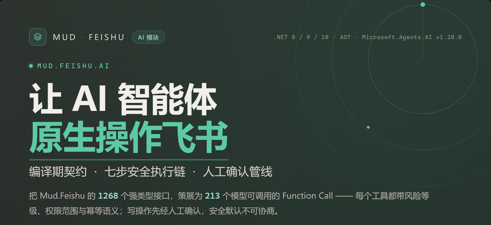
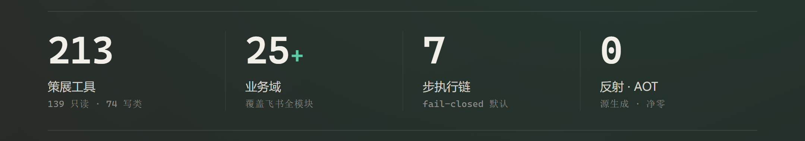
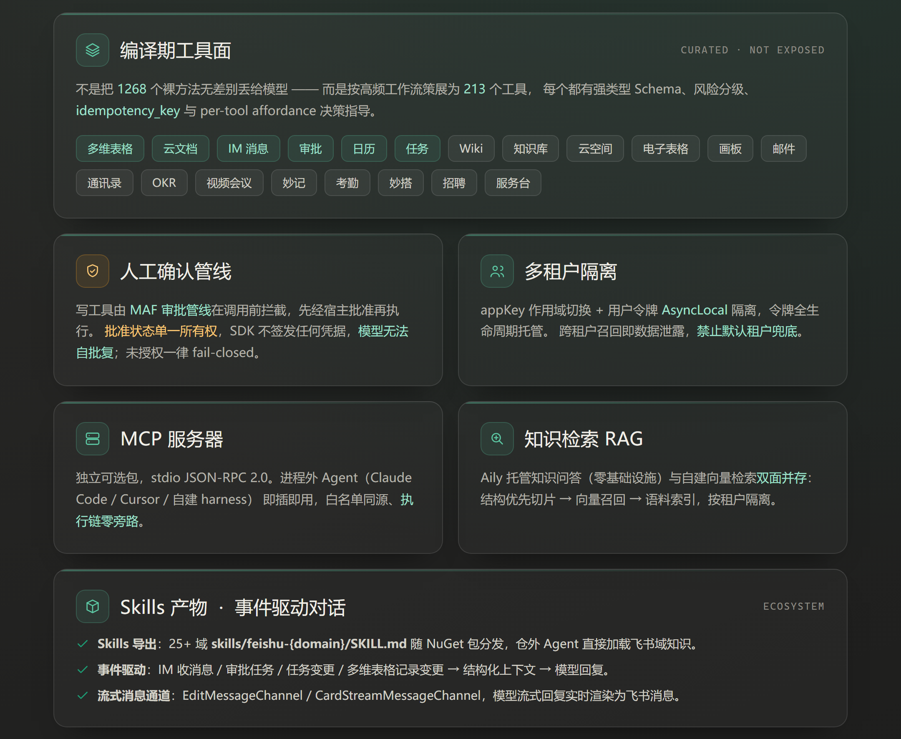
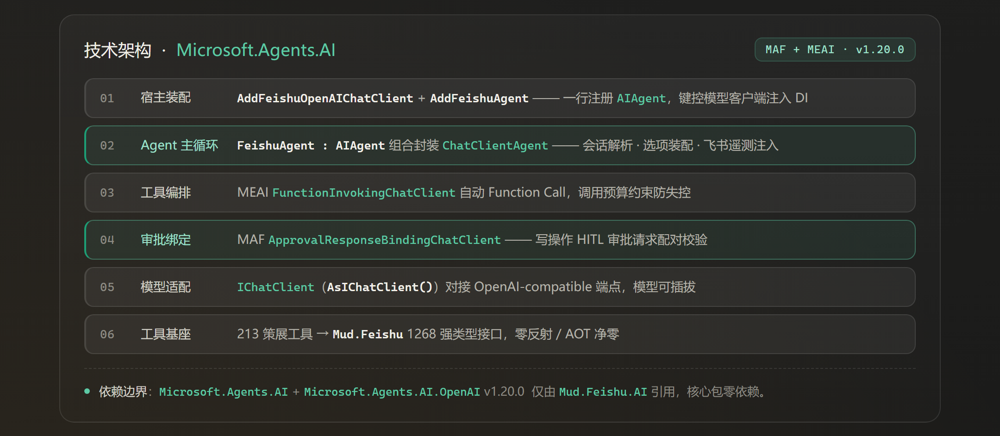
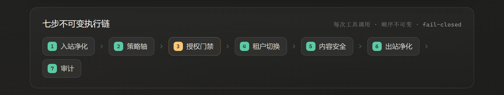
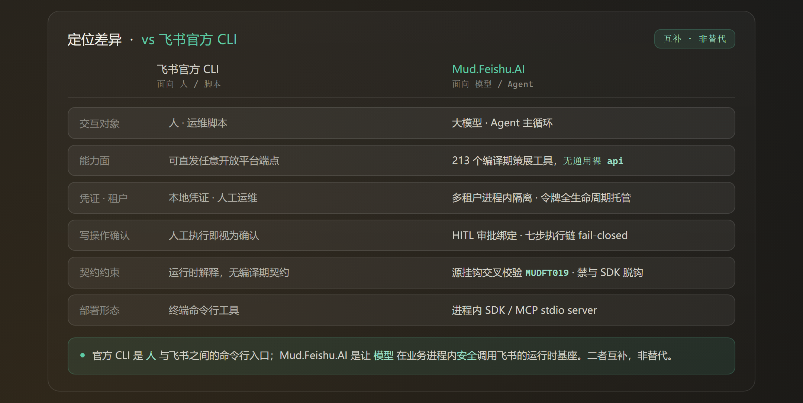
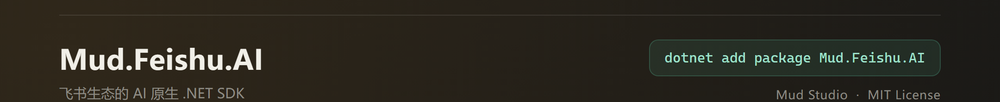

# 给大模型一双操作飞书的手：[Mud.Feishu.AI](http://Mud.Feishu.AI) 的设计取舍



## 这事为什么要单独开一个包

MudFeishu 本来是个挺规矩的 .NET 飞书 SDK。一千两百多个强类型接口，多租户令牌托管，WebSocket 长连，Webhook 回调，Redis 去重，该有的都有，而且一直被 AOT 严格模式和一堆契约守卫盯着。它的设计目标从第一天起就很清楚：给写代码的人用。

然后大模型闯了进来。你会发现一件很快就能体会到的事——SDK 好用，跟「模型好用」，完全是两码事。

把那一千两百多个接口原样怼给模型，大概率会得到三个结果：token 烧得飞快；它开始乱调写接口，而且挑的还是你最不希望它碰的那些；出事之后你翻不出它到底为什么删了那条记录。更尴尬的是，你甚至没法解释自己为什么允许它这么干。

所以我们做了个独立包 `Mud.Feishu.AI`。它不是「给 SDK 加个 AI 后缀」，而是一套**给模型准备的运行时**：把 SDK 的能力，按模型能理解、能被约束、能被审计的方式重新编排一遍。

一句话概括就是三件事：**编译期把工具面固定下来；每次调用都过同一条安全链；写操作默认关着，等人点头。**

## 三个包，各管一段

「`Mud.Feishu.AI`」严格说是三个包：

-   **`Mud.Feishu.AI`**——运行时本体。`FeishuAgent`、装配扩展、会话存储、知识检索、流式通道都在这里。它同时还是「共享接缝」的归属地：`[FeishuTool]` / `[ToolParameter]` 特性、`IFeishuToolContextAccessor`、`IFeishuToolApprovalChannel` 这些放在 `Mud.Feishu.AI.AgentTools` 命名空间下。之所以不塞进 Tools 包，是因为测试项目也要用 `[FeishuTool]`，但它不该去引 `Mud.Feishu.AI.Tools`——一引，它自己生成的工具 Schema 就和基座撞名了。
-   **`Mud.Feishu.AI.Tools`**——工具面。213 个 `[FeishuTool]` 声明按域放在 `Curation/`，配套的 `[FeishuToolHandler]` 独占 `Handlers/` 命名空间。两者刻意不同名，是为了让生成引擎能分别寻址「声明面」和「执行面」。
-   **`Mud.Feishu.AI.Mcp`**——进程外的 MCP 服务器，可选，不装也不影响前两个。

依赖是单向的：`Mcp → Tools → AI`。这是有意为之——想让工具面单独演进时，不必牵动运行时。



## 213 不是「少暴露」，是「重新编排」

先看几个数：**213** 个工具，其中 **139** 只读、**74** 写；写里面又分普通写 **58** 个、高风险写 **16** 个；按身份分，**198** 个走租户令牌、**15** 个走用户令牌；覆盖 **29** 个业务域 + 4 个元工具。

这 213 是怎么来的？不是按 OpenAPI 资源「一资源一工具」切出来的——飞书开放平台光端点就有两千多个，这么切模型根本记不住。我们是**按高频工作流策展**的。

举个具体例子。多维表格相关的接口有几十个，但模型真正要干的活其实就那几件：读记录、查字段、写记录、批量写入。那就给这几个；至于「查某个视图的筛选条件详情」这种接口，收起来。招聘模块更明显，OpenAPI 层面能拆出二十来个资源，我们最后收到按功能子域组织的几个工具就够用了。

每个工具身上挂的东西挺多的：

-   一份强类型 Schema（参数、必填、枚举，模型照着它填）；
-   风险等级（`read` / `write` / `high-risk-write`）和所需 scope；
-   一份 `source` 三元组，写明它背后是哪个 SDK 方法、哪个 HTTP 方法、哪条路由；
-   输出 Schema，把下游返回里该给模型看的部分挑出来；
-   幂等语义。凡是写操作，参数里都留了 `idempotency_key`；
-   一份叫 affordance 的「什么时候该用 / 什么时候不该用」说明。

最后这条是我个人觉得最值钱的地方。比如「转交审批」这个工具，它的 affordance 里会直接写：这条审批不该由我处理、或我没法判断时才转交；本来自己能处理的就别转，那只会让流程多走一圈；想提醒某人关注就去发消息，别乱转。这些东西没法靠文档链接指望模型去读，得写在工具的说明书里，跟工具一起进上下文。

另外有 4 个元工具值得单独提一句：`feishu.tool_search`、`feishu.schema_read`、`feishu.capability_lookup`、`feishu.guidance_read`。它们不发任何飞书请求，只查编译期的方法目录（1268 个方法）和域指引。模型不确定「这个能力有没有」的时候，先问它们，而不是硬猜一个接口去调。



## 底层：用 [Microsoft.Agents.AI](http://Microsoft.Agents.AI) 当基座，而不是自己造一套

做这类运行时有个岔路口：自己撸一遍 Agent 循环，还是站在现成的框架上。我们选了后者，用的是 `Microsoft.Agents.AI`（MAF）加 `Microsoft.Agents.AI.OpenAI`，锁在 v1.20.0。

选它有一个很实际的考虑：**依赖边界要干净**。MAF 这一对依赖，只有 `Mud.Feishu.AI` 引，核心包一个都不碰。你不用 AI 功能，就不会被拖进来任何东西。

装上去之后是六层：

1.  **宿主装配**——`AddFeishuOpenAIChatClient` 注册一个键控的模型客户端，`AddFeishuAgent` 一行把 `AIAgent` 注册进 DI。
2.  **Agent 主循环**——`FeishuAgent` 继承 MAF 的 `AIAgent`，里面组合封装了 `ChatClientAgent`，负责会话解析、选项装配、飞书侧遥测注入。
3.  **工具编排**——MEAI 的 `FunctionInvokingChatClient` 负责自动 Function Call，同时用调用预算把它框住（默认单轮最多 10 次工具调用）。
4.  **审批绑定**——MAF 的 `ApprovalResponseBindingChatClient` 负责把「写操作的人工确认」和原始请求配对。这一层是 HITL 能成立的关键，后面单独讲。
5.  **模型适配**——通过 `IChatClient`（`AsIChatClient()`）对接任意 OpenAI-compatible 端点，模型可插拔，换个 `modelId` 和端点即可。
6.  **工具基座**——213 个策展工具落到 `Mud.Feishu` 的 1268 个强类型方法上，全程零反射。



真到自己写代码的时候，装配就两段：

```csharp
// 1) 键控模型客户端（任意 OpenAI-compatible 端点）
builder.Services.AddFeishuOpenAIChatClient(
    serviceKey: "feishu-chat",
    modelId: "glm-4-flash",
    apiKey: builder.Configuration["Models:ApiKey"]!,
    endpoint: "https://open.bigmodel.cn/api/paas/v4");

// 2) 注册 Agent
builder.Services.AddFeishuAgent(builder.Configuration, o =>
{
    o.ModelServiceKey = "feishu-chat";
    o.Instructions    = "你是企业飞书助手，回答前先确认用户意图。";
    o.AllowedIdentities = ["tenant", "user"];        // 默认只有 tenant
    o.WriteAllowList    = ["approval.approve_task"]; // 写工具必须逐个列名
});


```

注意最后两行。写工具是**显式列名才启用**的，`WriteAllowList` 默认为空——也就是说，一个刚接上的 Agent，能读，不能写。这不是为了安全而安全，是因为我们见过太多「demo 很顺、上生产就出事故」的案例，而写接口出事是不可逆的。

## 每次调用都走同一条链

不管模型调的是哪个工具，执行路径都一样，顺序也不可改。七步：**入站净化 → 策略轴 → 授权门禁 → 租户切换 → 内容安全 → 出站净化 → 审计**。



「不可变」这几个字是刻意的。链上任何一步判定不放行，就直接 fail-closed，没有「跳过」、「降级」、「先放过去一会儿再说」这种选项。

-   **入站净化**：模型给的参数先洗一遍，越权的字段、超限的文本在这里就被挡下（比如翻译工具 1000 字符的上限，超了本地就拒，不会白白下发一次）。
-   **策略轴**：按配置的域级 / glob 规则过一遍，也在这一步按 `MaxToolRisk` 判风险上限，早于授权门禁。
-   **授权门禁**：`EnforceToolAuthorization` 默认开启，写工具再过 `IToolExecutionAuthorizer`（这个接口由宿主实现，SDK 只定义契约）。
-   **租户切换**：把 appKey 作用域切到这次调用该用的租户上，用户令牌走 AsyncLocal 隔离。
-   **内容安全**：出站扫描，默认是 `Warn` 模式。
-   **出站净化**：强制、无开关的安全基线，把返回值里不该进模型上下文的部分剥掉——密钥、加密配置这类字段，从源头上就不出现。
-   **审计**：每步都记，出事能倒查。

「净化」和「内容安全」是两回事，这点在代码里也写清楚了：净化是安全基线，强制、没有开关；内容安全是策略，宿主可以配。

## 写操作默认是关着的，而且模型没法自批复

上一节提到第四层 `ApprovalResponseBindingChatClient`，这里展开说。

场景是这样的：模型想调用 `approval.approve_task` 批一个审批。这个动作有副作用，得有人点头。想法很朴素——调之前先弹给宿主，宿主批准了再执行。

难点在于「批准」这件事怎么保证不被伪造。如果批准只是一个普通的聊天消息，那模型完全可以自己拼一条「我批准了」塞回上下文，然后工具照常执行。这类漏洞在早期 demo 里特别常见。

MAF 的做法是把「批准响应」和「原始审批请求」做绑定校验，配对不上的响应一律不认。`Mud.Feishu.AI` 这边只负责把审批要素交给宿主的批准通道（`IFeishuToolApprovalChannel`），**批准状态的所有权始终在框架和宿主手里，SDK 不签发任何凭据**。

另外，残留的审批请求如果没被应答就留在历史里，会让后续整段历史的配对校验失败——所以我们还得在入站消息处理时把悬空的审批请求清干净。这种细节看文档是想不到的，是踩出来的。

几个写工具的参数里还有个 `dry_run`。开上它，工具会返回「将要下发的 method/path 和请求体字段摘要」，但不真的调用下游。模型不确定的时候可以先预演一遍——比直接干下去再回滚便宜得多。

## 多租户不是加个字段那么简单

一个进程里托管多个飞书应用，是很多企业的真实需求（不同部门、不同子公司各一套应用）。这件事在 SDK 层是 `FeishuAppManager` 的活：它是单例，按 `appKey` 切换上下文，令牌全生命周期托管。

到了 AI 层，多租户最怕的是「跨租户召回」——A 租户的问话，检索出了 B 租户的数据。这种错一旦发生就是数据泄露，没法补救。

我们的做法是：令牌用 AsyncLocal 做隔离，租户切换是执行链上固定的一步，而且**不允许默认租户兜底**。宁可调用失败，也不允许「没指定就用默认的」这种便利。听起来很死板，但在多租户场景，「便利」几乎总是等于「事故」。MCP 形态也是同样的思路——跨租户宿主的正确形态是**每个租户一个 stdio 进程**，进程本身就是租户边界。

## 走出进程：MCP 与 Skills

进程内 SDK 是一种形态，但不是唯一的。

**MCP 服务器**做在 `Mud.Feishu.AI.Mcp` 里，是独立可选包，走 stdio 上的 JSON-RPC 2.0。这解决的是「Agent 不在我的进程里」的情况——比如你在用 Claude Code、Cursor，或者自己写了个 harness，它想调飞书。挂上这个 server，白名单同源，执行链一步不少、零旁路。`initialize` 时还能把已启用域的 guidance（路由、避坑、示例）作为 instructions 下发，让外部 Agent 先有个域认知。

**Skills 产物**是另一个方向。构建时会导出 `skills/feishu-{domain}/SKILL.md`，29 个域各一份，随 NuGet 包一起分发。仓外的 Agent 想了解「飞书审批这块能干什么」，读这份 [SKILL.md](http://SKILL.md) 就行，不用去啃 SDK 源码。仓库里已经有 Demo 把它当作真实消费方（读出来注入域 guidance）；仓库外目前还没有真实使用者，这个我们得实话实说。

## 门禁比功能多：那些防「假绿」的守卫

这类基础设施有个隐蔽的坑：测试全绿，不代表真的没问题。

我们踩过几次，印象比较深的是一个 AOT 严格模式的问题。增量构建的 up-to-date 检查只比对输入输出时间戳，**不看 csc 命令行参数**。结果就是：紧跟在普通构建后面跑的严格模式构建，直接跳过了编译，报出 0 个诊断——看着是绿的，其实压根没测。类似的「假绿」还有：测试进程起不来，仍然写出一个空的 TRX（退出码还是 1），光看「TRX 存在」就会误判通过。

所以现在质量门禁（`scripts/verify-build.ps1`）盯的是硬指标：0 构建错误、0 个 `CS1750`、0 个 `NU1603`（版本漂移），以及各类诊断计数必须为 0；AOT 严格模式还要加 `--no-incremental` 强制真编译，且断言构建错误为 0 而**不只看诊断计数**；测试按（测试项目 × TFM）逐个跑、逐个出 TRX，同时断言 TRX 存在**且**用例数大于 0。

还有一类守卫是冲着「契约脱钩」去的。每个工具的 `source` 三元组（SDK 方法 / HTTP 方法 / 路由）会跟真实 SDK 做交叉校验，对不上直接构建失败（诊断 `MUDFT019`）。目的是防止有人改了 SDK 接口、不动工具面，两边悄悄错位——这种事在运行前查出来最便宜。

坦白说，这一节里没有一行代码是「功能」，全是防自己人犯错的。但这类项目里，防错的价值往往比加功能高。

## 和飞书官方 CLI 的对照

聊到这里，一个常被问的问题绕不过去：飞书官方已经有 CLI 了，为什么还要这个？

先把结论放前面：**二者互补，不是替代。**

官方的 lark-cli 是「人和脚本操作飞书」的命令行入口，跑在终端里，广度优先，甚至留了一个 `api` 逃生口，能直接打任意开放平台端点。它面向的是「我知道我要干嘛，我想用命令干」。

`Mud.Feishu.AI` 面向的是「模型在业务进程里，得替我安全地把活干了」。它跑在进程内，深度优先，没有通用裸 `api` 工具。



差别体现在几处：

|  | 飞书官方 CLI | [Mud.Feishu.AI](http://Mud.Feishu.AI) |
| --- | --- | --- |
| 交互对象 | 人 · 运维脚本 | 大模型 · Agent 主循环 |
| 能力面 | 可直发任意开放平台端点 | 213 个编译期策展工具，**无通用裸 api** |
| 凭证 · 租户 | 本地凭证 · 人工运维 | 多租户进程内隔离 · 令牌全生命周期托管 |
| 写操作确认 | 人工执行即视为确认 | HITL 审批绑定 · 执行链 fail-closed |
| 契约约束 | 运行时解释，无编译期契约 | `source` 交叉校验（MUDFT019）· 禁与 SDK 脱钩 |
| 部署形态 | 终端命令行工具 | 进程内 SDK / MCP stdio server |

有两点得说明白。「无通用裸 `api` 工具」是我们**故意**的选择——给了模型一把万能钥匙，前面那些安全链基本就白搭了。另外那个「Skills 导出」目前只有仓库内 Demo 在用。

所以到底用哪个，判断标准很简单：**是要「人执行命令」，还是「让模型在业务里自主行动」**。前者用 CLI，后者用这个。真要两个都要，也不冲突：CLI 给人用，`Mud.Feishu.AI` 给 Agent 用。

## 五分钟上手

```bash
dotnet add package Mud.Feishu.AI
dotnet add package Mud.Feishu.AI.Mcp   # 需要给进程外 Agent 用时再加


```

然后按前面那段 `AddFeishuOpenAIChatClient` + `AddFeishuAgent` 注册，配上 `FeishuAgent` 配置节，就可以跑了。第一版建议先只开 `tenant` 身份、写工具一个不开，让它在读场景里跑顺了，再按需逐个放写工具——每个放开的写工具，都值得单独想一想「万一它真调了，后果是什么」。

配置项都集中在 `FeishuAgentOptions` 里，几个默认值值得记一下：`MaxToolCallsPerTurn = 10`、`MaxConcurrentTurns = 32`、`MaxToolResultLength = 4000`、`MaxToolRisk = "high-risk-write"`、`AllowedIdentities = ["tenant"]`、`ContentSafetyMode = Warn`。想收紧，直接改这些。

## 完整跑一遍：读多维表格，再写回记录

前面讲的都是设计，这节把一条真实链路从头走到尾：把多维表格里状态为「待办」的记录捞出来，处理完再改回「已完成」。挑这个场景，是因为它一个来回就把「读」「写」「人工确认」三件事都串上了。

先把这 9 个多维表格工具的位置摆清楚：`list_tables`、`list_fields`、`list_views`、`get_view`、`query_records`、`get_records_by_ids` 只读；`add_record`、`update_record` 是普通写；`delete_record` 归 high-risk-write。

**第一步，把写工具点名启用。** 写工具默认关着，要用 `update_record`，得在装配时列名：

```csharp
builder.Services.AddFeishuAgent(builder.Configuration, o =>
{
    o.ModelServiceKey   = "feishu-chat";
    o.Instructions      = "你是多维表格助手：先查再改，改前说明改哪条。";
    o.AllowedIdentities = ["tenant"];
    o.WriteAllowList    = ["bitable.update_record"];   // 写工具逐个点名
});
```

这里只放了 `update_record`，没放 `delete_record`。模型能改、删不了——从名单上就把删记录这条路断了。

**第二步，宿主实现批准通道。** 写工具要跑，光点名不够：执行链的「授权门禁」那步会找 `IToolExecutionAuthorizer`，「登记待确认」那步会找 `IFeishuToolApprovalChannel`。两个都是 SDK 只定契约、宿主自己实现。批准通道最省事的写法就是先登记下来：

```csharp
public sealed class HostApprovalChannel : IFeishuToolApprovalChannel
{
    private readonly ConcurrentDictionary<string, FrameworkToolApprovalRequest> _pending = new();

    // 框架原生审批请求：写工具在「执行前」被 MAF 拦下，在这里登记
    public Task<string?> RequestFrameworkApprovalAsync(
        FrameworkToolApprovalRequest request, CancellationToken ct = default)
    {
        _pending[request.RequestId] = request;                // 内含 ToolName / AppKey / ChatId
        return Task.FromResult<string?>(request.RequestId);   // 登记后立刻返回
    }

    // 老式「确认令牌」路径，保留兼容；新链路走上面那个
    public Task<string?> RequestApprovalAsync(
        ToolApprovalRequest request, CancellationToken ct = default)
        => Task.FromResult<string?>(null);
}
```

注意这个方法**不阻塞等人**——它只登记，登记完这一轮就结束，工具并没执行。人的决定是后面的事。

**第三步，正常起一轮，让模型自己去读。**

```csharp
var session  = await agent.GetOrCreateSessionAsync(conversationKey);
var response = await agent.RunAsync(
    "把多维表格 bascnAbc 里状态是「待办」的记录找出来，读一下「任务名称」。",
    session, options: null, cancellationToken);
```

这一轮模型会自己走：先 `list_tables` 拿 `table_id`，再 `query_records` 带上 `filter = "状态 = \"待办\""`、`field_names = ["任务名称"]` 取数和 `record_id`。它不会一上来就硬写——字段名拼错的话在本地就被拒了，不会白打一次飞书。

**第四步，一旦要写，工具会「停」在审批上。** 用户接着说「把第一条改成已完成」，模型要调：

```text
bitable.update_record(
    app_token = "bascnAbc",
    table_id  = "tblXxx",
    record_id = "recXxx",
    fields    = { "状态": "已完成" })
```

因为 `update_record` 在写名单里，`ApprovalResponseBindingChatClient` 会在调用**之前**把这次工具调用改写成审批请求，落到第二步那个通道里登记。这一轮返回的文本是空的——不是模型没说话，是「已发起确认」。宿主该做的，是把 `_pending` 里那条捞出来，在飞书卡片或工单里摆给用户看。

**第五步，人点同意，回灌续跑。**

```csharp
await agent.RunApprovalContinuationAsync(
    toolContextAccessor: sp.GetRequiredService<IFeishuToolContextAccessor>(),
    approval:            pendingRequest,      // 第四步登记的那条，原样回传
    approved:            true,
    reason:              "用户在卡片上确认",
    conversationGate:    gate,                // 与事件层同款闸门，保证同会话串行
    approvalChannel:     approvalChannel);
```

到这一步工具才真的执行，按 `record_id` 把 `fields` 写成「已完成」。要是续跑这轮模型又想调第二个写工具，它会**再要一次**审批，不会因为「刚批过」就一路放行。拒绝（`approved: false`）同样走完整流程，理由回填给模型。

最后两个参数在多维表格写工具的 schema 里是真实存在的，值得单独记一笔：

-   **`idempotency_key`**：写操作都带。同一个键重复提交只落一次、返回同一条记录。给个稳定值（比如「单据号+动作」），别用随机数——批准重试、网络重发全靠它兜底。
-   **`dry_run`**：开上它，工具只回「将要下发的 `PUT /…/records/{record_id}` 和请求体字段摘要」，不真调下游。拿不准时先预演，比改完再回滚便宜。

把这条链拉直了看，每一步都有它的用处：`WriteAllowList` 让删记录从源头不可能；「先 `query_records` 拿 `record_id` 再写」是 affordance 里写死的顺序；审批绑定让「同意」没法被模型自己伪造；`idempotency_key` 兜住重试。读是查出来的，写是点过头的，每一格也都留了痕——这就是 213 个工具在真实业务里跑起来的样子。

## 我们没做的事

写到这儿，也该把边界说清楚，免得误会。

-   **没有通用裸 `api` 工具**。如上所说，是故意的。想要「什么都能调」的灵活性，这个包不提供。
-   **写工具默认关着，授权要宿主自己实现**。`IToolExecutionAuthorizer` 只给了契约，SDK 不带现成的审批 UI、也不带租户级鉴权实现。这些是宿主业务的事。
-   **Skills 产物还没有仓外使用者**。目前只是把域知识导出成标准形态，方便外部 Agent 接。
-   **工具数一律以 `FeishuToolSchemas.golden.txt` 为准**。它是生成产物，别手改；文档里的数字对不上时也以它为准（当前 213：139 读 + 74 写）。这篇文里的数字都按 golden 文件校准过。
-   **它不解决「模型靠不靠谱」**。工具面再整齐、执行链再严，也只是把「模型出错时的损失」控制在一个可接受范围里。它管的是安全边界，不是模型质量。

## 结语

回到最开始那句话：SDK 好用，跟「模型好用」是两件事。

`Mud.Feishu.AI` 想干的，是把这两件事之间的那道缝补上——不是让模型能碰到飞书，而是让它能**安全地**碰到飞书：能力面在编译期就定死，每次调用都走同一条链，写操作默认关着，出事的每一步都留痕。

它不追求「什么都能干」。恰恰相反，它的大部分设计都在回答同一个问题——**怎么让模型少干点不该干的事**。



* * *

*Mud Studio · MIT License · `dotnet add package Mud.Feishu.AI`*